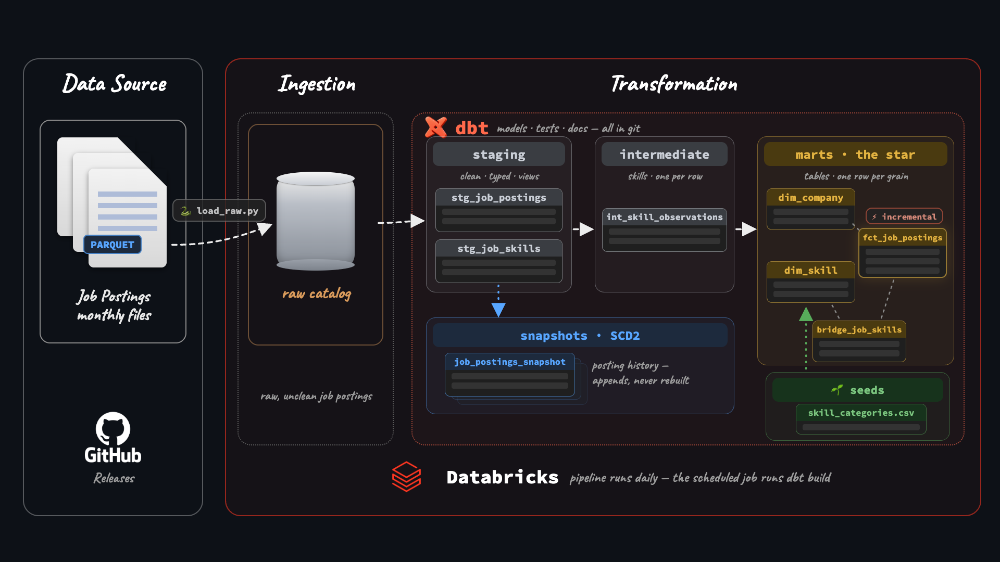

# Production Job postings Pipeline-dbt+ databricks

A production dbt pipeline on **Databricks**

Over 843,097 raw job posting scrapes, rebuild nightly by scheduled job with zero secrets

- Shape medallion layers into a tested star schema  - 491140 jobs at a declared grain 

- Tracks a year of salary history with SCD2 Snapshots -504591 version rows

- Loads incrementally and runs  itself on databricksJobs  - no token anywhere